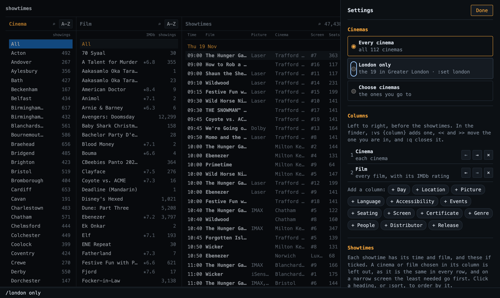
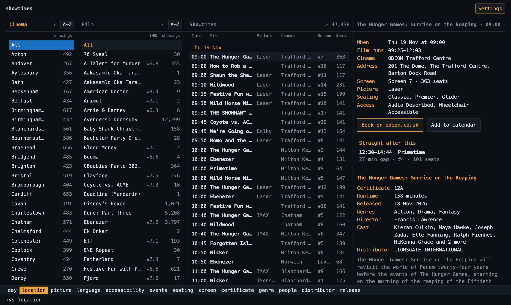

# showtimes

[](https://github.com/RoshBeed/showtimes/actions/workflows/ci.yml)
[](https://github.com/RoshBeed/showtimes/actions/workflows/deploy.yml)
[](https://github.com/RoshBeed/showtimes/actions/workflows/ingest.yml)

**Live site: [showtimes.ramuk.net](https://showtimes.ramuk.net)** · Greater London only:
[showtimes.ramuk.net/?cinemas=london](https://showtimes.ramuk.net/?cinemas=london)

What's on at the cinema, on which screen, and how big that screen is. Pick a
cinema, a film, a day or a format in columns side by side; each column counts
what the others leave, and the matching showtimes and their details stay in
view. Nothing is booked here: each showing links to its cinema's own booking
page and can be added to your calendar.

The listings come from cinema chains, each through an adapter of its own.
ODEON is the first; [adding a chain](#adding-a-chain) is a module on each side.


## Using the site

1. **Choose where.** Open **Settings** (top right, or `:set`) and pick *Every cinema*,
   *London only*, or *Choose cinemas* to tick the ones you go to.
2. **Choose your columns.** Settings lists the columns you show, left to right;
   move or remove each, and add others: Day (with Today and This weekend), Film,
   Cinema, Location, Picture, Language, Accessibility, Events, Seating, Screen
   (biggest first), Certificate, Genre, People, Distributor and Release (out now or
   opening soon).
3. **Narrow it down.** Pick something in any column. Every column shows how many
   showings each choice would leave, and **All** at the top of each takes a choice
   back. Search a column with `/`, narrow it with `:filter`, and order it A–Z, by
   number of showings or (films) by rating with `:sort`.
4. **Pick a showtime.** The showtimes are a table: click a heading to order by
   it, and click it again to reverse. Settings chooses what each row shows
   besides its time and film: end time, picture, language, access, certificate,
   cinema, screen and seats. A showtime's details show beside it: the screen and its seats, the
   film's own start and end, the picture format, seating and access, the films
   you could see straight before or after it (double bills), and the film's
   synopsis, ratings and trailer. **Book on …** opens the cinema's own booking page.
5. **Bookmark it.** The columns, your choices in them and your cinemas are all in
   the page address, and nothing is stored in the browser. A bookmark is a saved
   view, and a shared link opens the same way for anyone.

Concerts, theatre, opera and other special events are left out unless you switch
them on in Settings. On a computer the footer says how fresh the listings are and
how far every chain's full schedule runs; days after that hold advance bookings only.



### On a phone

One column shows at a time. The row of buttons along the top names each column
and what is chosen in it; tap one to go back to it. Choosing something moves on to
the next column, and tapping a showtime opens its details.

<p>
  
  
  
</p>

### Keys

The finder is driven as vim is: each column is a window and each choice or showtime
a line, so the habits carry over. Counts work (`5j`, `3l`, `12G`), commands go on the
command line at the foot, Tab completes them as vim's wildmenu does, and `:help` on
the site lists all of this.



| Normal mode | Does |
| --- | --- |
| `h l ← →` | The column to the left or right; also w b, Backspace Space |
| `j k ↓ ↑` | Down or up a line: choose in a column, or move through the showtimes |
| `Enter -` | Into the next column, or back out of it, as in netrw |
| `0 ^ $` | The first column, or the showtimes |
| `gg G` | The first or last line; with a count, that line (12G) |
| `Ctrl-d Ctrl-u` | Half a screen down or up |
| `Ctrl-f Ctrl-b` | A screen down or up |
| `Ctrl-e Ctrl-y` | Scroll a line down or up |
| `H M L` | The top, middle or bottom line on screen |
| `zz zt zb` | Scroll the line to the middle, top or bottom |
| `{ }` | The previous or next day of showtimes |
| `/ ?` | Search forward or back in the column (smartcase, regular expressions) |
| `n N` | The next or previous match |
| `<< >>` | Move the column left or right |
| `dd` | Hide the film everywhere |
| `yy` | Yank (copy) the link to this view |
| `u Ctrl-r` | Undo or redo |
| `m{a-z}` | Mark this view; then ‘{a-z} or `{a-z} comes back to it |
| `gx` | Open the showing on its cinema’s site to book it |
| `K` | Play the film’s trailer |
| `Ctrl-g` | Where you are |
| `Esc` | Cancel a count or a half-typed command |

| Command | Does |
| --- | --- |
| `:vs {column}` | Split: add a column (day, film, cinema, location, picture, language, access, events, seating, screen, cert, genre, people, distributor, release) |
| `:q :close` | Close the column |
| `:only` | Close every other column |
| `:sort :sort n :sort rating` | Order a column A–Z, by showings, or (films) by rating |
| `:sort {by} :sort! {by}` | Order the showtimes by date, time, film, cinema, screen or seats; ! reverses |
| `:filter {text}` | Keep only the lines with that text; :filter alone shows them all again |
| `:set` | Settings |
| `:set london nolondon london!` | London only on, off, or switched |
| `:set events noevents` | Event cinema shown or left out |
| `:set fields=… fields+=ends fields-=picture fields&` | What each showtime shows (ends, picture, language, access, cert, cinema, screen, seats); & is the default |
| `:{number}` | That line |
| `:w` | Copy the link to this view |
| `:e!` | Start over: every cinema, the default columns, nothing hidden |
| `:cal` | Add the showing to your calendar |
| `:help F1` | This list |

The settings drawer (`:set`) reads as a buffer too, a line to each choice:

| In settings | Does |
| --- | --- |
| `j k ↓ ↑` | The next or previous line |
| `h l ← →` | Along a line, such as a column’s ← → × |
| `gg G Ctrl-d Ctrl-u` | The top, the bottom, half a screen |
| `Space Enter` | Tick, choose or press what is on the line |
| `/ ? n N` | Search the lines: /aber then Space ticks Aberdeen |
| `i` | Type in the cinema search; Esc leaves it |
| `dd << >>` | Remove a column, or move it left or right |
| `u Ctrl-r` | Undo or redo |
| `q Esc :q` | Close the drawer |

Everything also works by clicking or tapping.

## How it works

There is no server. A GitHub Actions workflow fetches each chain's listings into
a SQLite file of its own, on that chain's schedule. The site is plain files on
GitHub Pages; the browser downloads the listings once (under 1 MB, about 200 kB
with London only) and keeps them in memory, so every key press is answered at once.

### How it is put together

| Part | Where | What it does |
| --- | --- | --- |
| Ingest | `ingest/` (Python) | A core (the shared schema, the runs, IMDb and Metacritic ratings) and a package for each chain in `chains/` that fetches it into its own SQLite file |
| Export | `site/src/export.ts`, `site/src/chains/` | At build time, reads every chain's file through that chain's module, which names its tags, towns, seats and booking link in the shared vocabulary, and writes the JSON the page downloads |
| Site | `site/src/` (TypeScript, Vite) | The interface; it knows no chain's own strings |
| Listings | the `data` release of this repository | Each chain's `<chain>.sqlite.gz`; also its ingest's only memory between runs |
| Workflows | `.github/workflows/` | `Ingest` (each chain's schedule), `Deploy` (GitHub Pages), `CI` |

A chain's stored file stays its raw record, so how it reads can change at the
next build without fetching anything again.

**ODEON** publishes each week's listings on a Tuesday, so its check runs hourly
on Tuesdays and Wednesdays; once the week is stored a check contacts nobody. When
the file changes the workflow calls Deploy, which builds the new listings into
the site. ODEON refuses requests from cloud providers' addresses, GitHub's runners
included, so its traffic goes through a Tailscale exit node on a home network
(`scripts/via-tailnet.sh`). Nothing else uses it.

### Adding a chain

1. **Ingest:** a package in `ingest/src/showtimes_ingest/chains/<chain>/` that
   writes the shared schema (`store.py`) and offers what `chains/__init__.py`
   lists: `NAME`, `check`, `ingest`, `settled_reason` and `search_title`. Add it
   to `CHAINS` there, with tests against a fake of the chain.
2. **Export:** a module in `site/src/chains/<chain>.ts` implementing `Chain`
   (`chain.ts`): its name, booking link, cinema names and towns, how its tags,
   seats and distributors read, which showings are special events, and how far
   its schedule is published. Add it to `CHAINS` in `index.ts`.
3. **Workflow:** an ingest job for the chain on its own schedule, publishing
   `data/<chain>.sqlite` with `scripts/listings.sh upload <chain>`. Deploy builds
   every published file into the site.

Check first that the chain's terms allow it, and keep its traffic to what its
schedule needs: one ingest per published week, no retry loops.

### Repository settings

| Kind | Name | Purpose |
| --- | --- | --- |
| Secret | `TAILSCALE_STATE` | The runner's permanent identity on the tailnet (base64 of a tailscaled state file) |
| Secret | `OMDB_API_KEY` | Optional. Enables IMDb and Metacritic scores |
| Variable | `TAILSCALE_EXIT_NODE` | Name of the exit node device |
| Variable | `ODEON_CINEMAS` | Optional. ODEON site IDs to store, comma-separated; empty stores every cinema |
| Variable | `ODEON_INGEST` | Optional. `false` pauses ODEON's schedule |

Start an ingest by hand:

```bash
gh workflow run ingest.yml -f command=run
```

`check` ingests only if the chain's latest listings are not stored yet; `run`
ingests now. A failed ingest is recorded in the chain's file and tried again at
the next check, at most three times a week.

## Working on it

The site needs the chains' listings files to show anything:

```bash
scripts/listings.sh download
```

Then, in `site/` (Node 26):

```bash
npm install
```

```bash
npm run listings
```

```bash
npm run dev
```

```bash
npm test
```

In `ingest/` (Python 3.13, [uv](https://docs.astral.sh/uv/)):

```bash
uv run python -m unittest discover -s tests
```

The ingest tests use a fake of each chain and a temporary database. To keep the
chains' traffic minimal, do not run a real ingest more than its schedule does.
