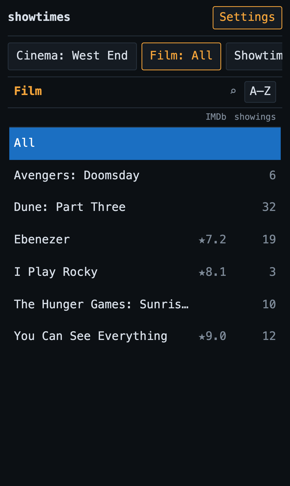
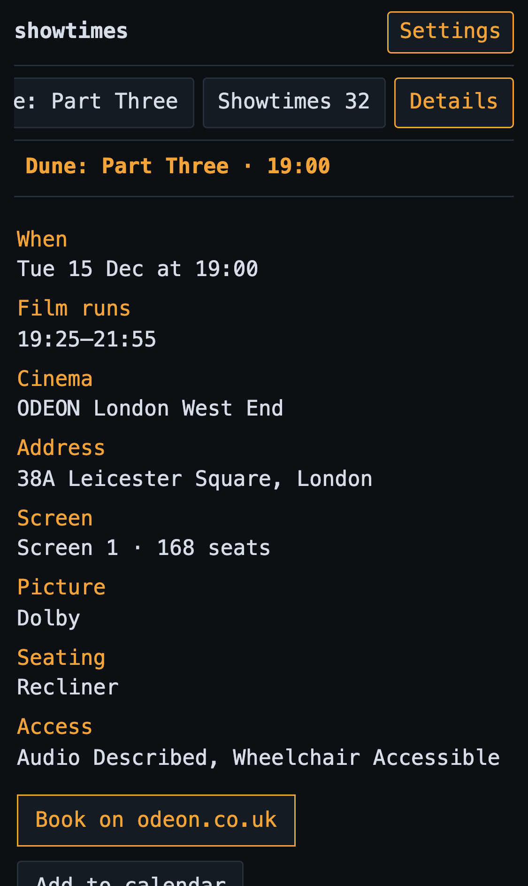

# showtimes

**[showtimes.ramuk.net](https://showtimes.ramuk.net)**: what's on at the cinema, on
which screen, and how big that screen is. Greater London only:
[showtimes.ramuk.net/?cinemas=london](https://showtimes.ramuk.net/?cinemas=london).

Every showing at ODEON, Vue, Cineworld, Everyman, Picturehouse, Curzon, Showcase,
The Light, Reel and Olympic Studios, and at London's Prince Charles, Rio, Lexi,
Phoenix and ActOne, in one place. Listings are refreshed every week.

## Finding a film

- **Choose your cinemas** in **Settings** (in the footer; on a phone, at the end of the top row): every cinema, London only, or
  the ones you go to.
- **Narrow it down** by picking in the columns: cinema, film, day, and any others you
  add in Settings, such as screen size, picture format, language or accessibility.
  Each column counts what the others leave. Pick several in one column with Shift-click
  (a run of lines) or Ctrl/Cmd-click (one more), and a showing matching any of them is shown.
- **Pick a showtime** to see its screen and seats, double bills, synopsis, ratings
  and trailer. **Book on …** takes you to the cinema's own booking page, and you can
  add the showing to your calendar.
- **Bookmark or share** the page: the address keeps your cinemas, columns and
  choices, so a link opens exactly the same view.

Concerts, theatre and other special events are hidden unless you switch them on in
Settings.

## On a phone

One column shows at a time. Tap a choice to move on, and tap the buttons along the
top to go back.

  
  
  

